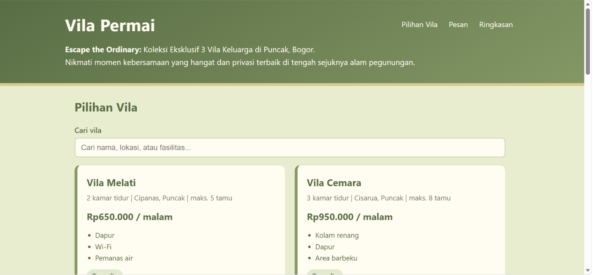
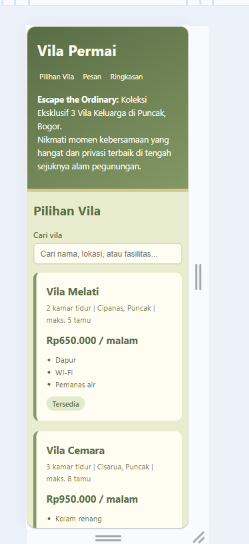
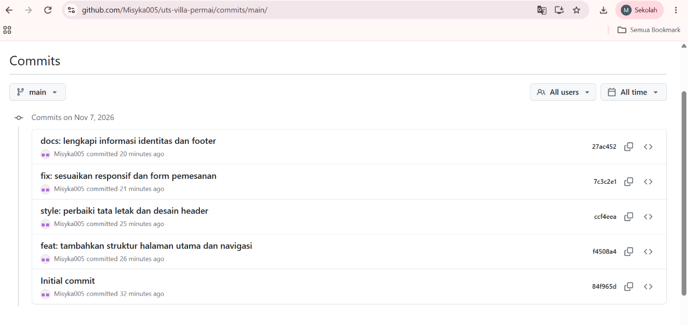

# Vila Permai – Aplikasi Pemesanan Vila

**Nama:** Misykatul Fazriyah
**NIM:** 24011130446
**Repository:** uts-vila-permai-24011130446

## Deskripsi
Halaman web statis untuk calon tamu Vila Permai di Puncak, Bogor. Tamu bisa melihat tiga vila, mencari vila, melihat total biaya otomatis, lalu mengirim pesanan. Tanpa server dan tanpa basis data.

## Cara menjalankan
1. Unduh atau clone repository ini.
2. Buka file `index.html` di peramban (klik dua kali).

## Fitur yang sudah selesai
- Struktur HTML5 semantik (header, nav, main, section, article, footer)
- Tiga kartu vila yang dirender dari array objek JavaScript
- Form pemesanan dengan validasi pesan berbahasa Indonesia
- Hitung total biaya otomatis (harga x malam x faktor tamu)
- Pencarian vila berdasarkan nama, lokasi, atau fasilitas
- Simpan nama terakhir dan daftar pesanan di localStorage
- Desain responsif (breakpoint 768px dan 480px), hover, dan animasi

## Fitur yang belum selesai
- Pesanan belum terkirim ke pemilik (belum ada server); data hanya tersimpan di peramban.
- Belum ada kalender visual untuk melihat tanggal terisi.

## Tangkapan layar

### 1. Tampilan Desktop

### 2. Tampilan Mobile

### 3. Riwayat Commit GitHub
